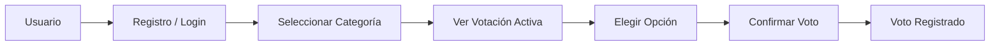

# FUNDACIÓN UNIVERSITARIA DEL ÁREA ANDINA
### FACULTAD DE INGENIERÍAS Y CIENCIAS BÁSICAS — PROGRAMA DE INGENIERÍA DE SISTEMAS

---

# SISTEMA WEB DE VOTACIONES
## FESTIVAL DE LA LEYENDA VALLENATA 2027

**Entrega 1: Descubrimiento, análisis de requerimientos y diseño inicial**  
**Asignatura:** Desarrollo Web  
**Modalidad:** Virtual (Trabajo en equipo de 4 estudiantes)  
**Fecha límite:** 12 de octubre de 2026  
**Ámbito:** Colombia  

---

## 1. Portada y Datos Generales

| Campo | Información |
| :--- | :--- |
| **Institución** | Fundación Universitaria del Área Andina |
| **Programa** | Ingeniería de Sistemas |
| **Asignatura** | Desarrollo Web |
| **Proyecto** | Sistema Web de Votaciones – Festival de la Leyenda Vallenata 2027 |
| **Etapa** | Analizar y diseñar (Entrega 1: No desarrollar código funcional todavía) |

---

## 2. Integrantes y Organización del Equipo

De acuerdo con los lineamientos metodológicos de la asignatura, el proyecto se estructuró dividiendo las responsabilidades entre los 4 integrantes según especialidades y dependencias técnicas para garantizar un esfuerzo equilibrado:

| Rol / Especialidad | Integrante Responsable | Actividades Asignadas |
| :--- | :--- | :--- |
| **UX/UI & Experiencia de Usuario** | Integrante 1 | **Actividad 12:** Prototipo navegable de 14 pantallas en Figma.<br>**Actividad 13:** Diagrama del flujo principal del usuario. |
| **Análisis Funcional & Casos de Uso** | Integrante 2 | **Actividad 5:** Identificación de actores.<br>**Actividad 6:** Requerimientos Funcionales.<br>**Actividad 8:** Reglas de Negocio.<br>**Actividad 10:** Casos de Uso UML. |
| **Arquitectura, Datos & Viabilidad** | Integrante 3 | **Actividad 7:** Requerimientos No Funcionales.<br>**Actividad 11:** Modelo Conceptual de Datos.<br>**Actividad 14:** Matriz de Riesgos.<br>**Actividad 15:** Arquitectura preliminar. |
| **Descubrimiento, Alcance & PM** | Integrante 4 | **Actividad 1:** Contexto.<br>**Actividad 2:** Benchmarking.<br>**Actividad 3:** Problema y Objetivos.<br>**Actividad 4:** Alcance preliminar.<br>**Actividad 9:** 10 Preguntas al Cliente.<br>**Coordinación:** Integración del documento final. |

---

## 3. Contexto del Festival de la Leyenda Vallenata (Actividad 1)

### 3.1. ¿Qué es el Festival de la Leyenda Vallenata?
El Festival de la Leyenda Vallenata es el certamen folclórico y cultural más emblemático de la música tradicional en Colombia. Celebrado anualmente en Valledupar (Cesar) desde 1968 bajo la organización de la **Fundación Festival de la Leyenda Vallenata (FFLV)**, su propósito fundamental es conservar y salvaguardar los cuatro aires autóctonos: *paseo, merengue, son y puya*. En 2015, la música vallenata tradicional fue declarada por la UNESCO como Patrimonio Cultural Inmaterial de la Humanidad.

### 3.2. Principales actividades del festival
* **Desfile de Piloneras:** Apertura multitudinaria protagonizada por comparsas de danza tradicional en categorías infantil, juvenil y mayores.
* **Rondas eliminatorias de concursos:** Competencias musicales desarrolladas simultáneamente en tarimas y plazas públicas de Valledupar (Plaza Alfonso López, Coliseo de Feria Ganadera, Parque de la Leyenda Vallenata).
* **Foros y conversatorios académicos:** Jornadas de reflexión pedagógica y homenajes anuales a juglares, compositores e intérpretes consagrados.
* **Gran final y galas de premiación:** Noches de coronación y conciertos masivos en el Parque Consuelo Araújo Noguera para la elección de los nuevos reyes del festival.

### 3.3. Concursos y categorías existentes
1. **Acordeón Profesional:** Máxima distinción que otorga el título de *Rey Vallenato*.
2. **Acordeón Aficionado, Juvenil e Infantil:** Escalafones formativos por edad que aseguran el relevo generacional.
3. **Acordeón Femenino:** Competencia oficial en categorías Mayor y Menor.
4. **Canción Vallenata Inédita:** Concurso para compositores líricos en los cuatro ritmos oficiales.
5. **Piqueria:** Duelo de repentismo, rima e improvisación poética cantada (Mayor e Infantil).
6. **Danza de Piloneras:** Calificación coreográfica y de vestuario de agrupaciones de baile tradicional.

### 3.4. Tipos de participantes y actores del entorno
* **Concursantes e intérpretes:** Músicos (acordeoneros, cajeros, guacharaqueros, cantantes, versadores y compositores) inscritos formalmente.
* **Agrupaciones de comparsas:** Grupos de danza, directores de comparsas y comitivas folclóricas.
* **Jurados oficiales:** Paneles de expertos designados por la FFLV que deliberan la técnica musical en tarima.
* **Audiencia y comunidad (Votantes potenciales):** Espectadores presenciales y remotos que siguen las transmisiones y buscan apoyar a sus artistas preferidos mediante voto digital.

### 3.5. Experiencias previas de votación y participación digital
Tradicionalmente, las deliberaciones han sido manuales y restringidas a los jurados oficiales en tarima. Sin embargo, eventos análogos de alta masividad (como el Festival Internacional de la Canción de Viña del Mar o premiaciones de la industria musical) han integrado votaciones digitales populares. Dichos antecedentes evidencian riesgos clave: saturación de servidores por avalanchas simultáneas de peticiones en vivo, intentos de fraude con bots y duplicación de votos, y desconfianza del público si no existen mecanismos transparentes de auditoría y limitación de participación.

### 3.6. Diagnóstico del sitio web actual y justificación del sistema
El portal oficial de la FFLV ([festivalvallenato.com](https://festivalvallenato.com)) es primordialmente informativo y noticioso. Publica cronogramas, boletines de prensa, reglamentos de inscripción y enlaces a operadores externos de boletería. El sitio no dispone de un subsistema transaccional capaz de autenticar votantes, parametrizar categorías dinámicas, controlar ventanas de votación en vivo y resistir altos picos de concurrencia sin comprometer la disponibilidad del portal principal.

---

## 4. Benchmarking de Plataformas de Votación (Actividad 2)

Se analizó comparativamente el funcionamiento de tres referentes tecnológicos de votación digital:

| Aspecto Evaluado | 1. ElectionBuddy | 2. StrawPoll | 3. Festival de Viña del Mar |
| :--- | :--- | :--- | :--- |
| **Propósito** | Elecciones formales de juntas directivas, asambleas y premiaciones institucionales auditables. | Sondeos públicos masivos y votaciones inmediatas en comunidades web y streaming. | Medición en vivo de la preferencia del público para otorgar reconocimientos y galardones populares. |
| **Registro** | Token unívoco enviado por correo o SMS (enlace privado de un solo uso por elector). | Flexible: sin registro obligatorio (IP + huella de navegador) o inicio de sesión social rápido. | Registro ágil con correo o redes sociales (OAuth) para evitar fricción durante la transmisión en vivo. |
| **Navegación** | Acceso directo mediante enlace unívoco o catálogo cerrado asignado al usuario. | Búsqueda directa, enlace URL corto, código QR en pantalla o categorías destacadas. | Menú contextual sincronizado con el cronograma del evento y notificaciones push en tiempo real. |
| **Votación** | Selección de opción con pantalla intermedia obligatoria de confirmación previa. | Clic directo sobre la opción elegida y botón de confirmación en pantalla única. | Calificación numérica o selección de artista durante una franja temporal estricta (ej. 2-3 min). |
| **Resultados** | Reportes tabulares y gráficos configurables (públicos, privados o diferidos hasta el cierre). | Gráficos de barras y porcentajes interactivos en tiempo real inmediatamente tras emitir el voto. | Consolidado porcentual transmitido en vivo únicamente tras cerrarse la ventana de votación. |
| **Seguridad** | Cifrado extremo a extremo, prevención estricta de votos duplicados y auditoría certificada. | Protección contra bots (Cloudflare Turnstile / reCAPTCHA), cookies seguras y filtrado de IPs. | Validación de una cuenta/dispositivo por votación y ventanas cortas de apertura controlada. |
| **Aprendizaje para el proyecto** | Adopción de pantalla de confirmación antes de guardar el voto y visibilidad diferida de resultados. | Navegación limpia con acceso mediante códigos QR proyectados en tarima o televisión. | Optimización estricta para teléfonos móviles y gestión por ventanas temporales controladas. |

---

## 5. Problema Identificado (Actividad 3)

La Fundación Festival de la Leyenda Vallenata (FFLV) carece de una solución tecnológica centralizada, escalable y auditable que permita al público general participar activamente en la elección de sus artistas favoritos durante las diferentes etapas del festival.

Actualmente, los mecanismos de evaluación dependen exclusivamente de jurados cerrados o canales informales que no garantizan la integridad del voto, no soportan la alta concurrencia propia de las transmisiones en vivo y carecen de trazabilidad. Asimismo, no existe una herramienta institucional que permita a los organizadores configurar, habilitar y auditar dinámicas de votación de manera ágil (por categorías, comparsas, canciones o reconocimientos) sin tener que recurrir a desarrollos a la medida para cada edición.

---

## 6. Objetivos del Proyecto (Actividad 3)

### 6.1. Objetivo General
Diseñar la propuesta técnica, conceptual y de experiencia de usuario de una **plataforma web de votaciones configurable, intuitiva, segura y escalable** para el Festival de la Leyenda Vallenata 2027, que permita parametrizar dinámicas de votación por edición y garantice la emisión transparente de votos por parte de la comunidad desde dispositivos móviles y de escritorio.

### 6.2. Objetivos Específicos
1. **Levantar y estructurar los requerimientos:** Identificar las necesidades funcionales, atributos de calidad no funcionales y reglas de negocio para los actores del sistema (Visitante, Votante y Administrador), diferenciando elementos confirmados de los pendientes de validación.
2. **Modelar la lógica de negocio y datos:** Diseñar el modelo conceptual de datos (Edición, Categoría, Votación, Opción, Usuario, Voto) y los casos de uso esenciales para asegurar la unicidad y consistencia de cada voto.
3. **Diseñar la experiencia de usuario (UX/UI):** Elaborar un prototipo navegable e interactivo con enfoque *mobile-first* para las interfaces pública y administrativa, optimizando el flujo de votación y minimizando la tasa de abandono.
4. **Definir la arquitectura tecnológica y evaluar riesgos:** Estructurar la arquitectura preliminar basada en Django MVT y MySQL, identificando riesgos de concurrencia y seguridad para proponer estrategias de mitigación viables.

---

## 7. Alcance Preliminar (Actividad 4)

| Elemento del Sistema | Estado | Justificación Técnica / Negocio |
| :--- | :---: | :--- |
| **Configuración de Ediciones y Categorías** | ✅ Incluido | Permite que la plataforma sea reutilizable en ediciones futuras y clasifique los concursos oficiales. |
| **Gestión de Votaciones y Opciones** | ✅ Incluido | Permite al administrador crear dinámicas de votación, asociarles concursantes y habilitar/cerrar estados. |
| **Registro y Autenticación de Votantes** | ✅ Incluido | Garantiza la trazabilidad del usuario y constituye la base para evitar la duplicidad de votos. |
| **Emisión y Confirmación de Voto** | ✅ Incluido | Flujo transaccional central: selección de opción, pantalla de confirmación y registro en base de datos. |
| **Regla de Unicidad de Voto** | ✅ Incluido | Restringe la participación a un único voto por usuario registrado por cada votación activa. |
| **Panel de Administración y Métricas** | ✅ Incluido | Facilita al comité organizador monitorear los sufragios y consolidar los reportes de resultados. |
| **Diseño Web Responsive (Mobile-First)** | ✅ Incluido | Optimiza la navegación para el dispositivo predominante del público durante los eventos en vivo. |
| **Calificación Técnica de Jurados Oficiales** | ⛔ No incluido | El sistema es exclusivamente de voto popular; la deliberación de jurados técnicos se mantiene bajo sus protocolos en tarima. |
| **Venta y Pasarela de Pagos de Boletería** | ⛔ No incluido | La boletería se delega a operadores especializados externos (TuBoleta) para evitar intermediaciones financieras innecesarias. |
| **Transmisión de Streaming en Vivo** | ⛔ No incluido | Para preservar el ancho de banda y rendimiento del servidor de votaciones; se delega a YouTube y redes oficiales. |
| **Aplicación Móvil Nativa (iOS / Android)** | ⛔ No incluido | Se prioriza una aplicación web responsive accesible desde cualquier navegador para maximizar compatibilidad y reducir costos. |
| **Método Definitivo de Autenticación** | ❓ Pendiente de validación | Sujeto a definición con la FFLV sobre si se exige cédula de ciudadanía, correo/contraseña o login social OAuth. |
| **Política de Publicación de Resultados** | ❓ Pendiente de validación | Pendiente acordar si los porcentajes se muestran en tiempo real o permanecen ocultos hasta la ceremonia de premiación. |
| **Integración con Subdominio Institucional** | ❓ Pendiente de validación | Requiere validación y permisos de la infraestructura de TI de la FFLV (ej. votaciones.festivalvallenato.com). |
| **Sincronización con Base de Datos de Inscritos** | ❓ Pendiente de validación | Pendiente validar si los concursantes se cargarán manualmente en el panel o mediante exportación/API institucional. |

---

## 8. Identificación de Actores del Sistema (Actividad 5)

A partir del análisis de la dinámica del festival y la interacción de usuarios, se definieron los tres actores fundamentales del sistema:

1. **Visitante (Usuario no autenticado):**
   * **Propósito:** Explorar la plataforma, conocer categorías del festival y consultar votaciones activas.
   * **Responsabilidades:** Navegar el catálogo y realizar el proceso de registro si desea participar.
   * **Acciones:** Ver página de inicio, explorar categorías, ver detalle de votación, registrarse e iniciar sesión.
   * **Restricciones:** No puede emitir votos ni acceder a paneles administrativos.

2. **Votante (Usuario autenticado):**
   * **Propósito:** Participar activamente eligiendo a sus concursantes favoritos en las categorías habilitadas.
   * **Responsabilidades:** Respetar las políticas de votación y confirmar su elección conscientemente.
   * **Acciones:** Seleccionar opciones, confirmar voto, visualizar constancia de sufragio y consultar resultados públicos.
   * **Restricciones:** Máximo un voto por votación activa; no puede modificar un voto ya emitido ni alterar datos ajenos.

3. **Administrador (Comité Organizador FFLV):**
   * **Propósito:** Gestionar el ciclo de vida de las votaciones y monitorear la integridad del proceso.
   * **Responsabilidades:** Configurar ediciones, categorías, opciones y apertura/cierre de votaciones.
   * **Acciones:** Crear y editar votaciones, asociar concursantes, abrir/cerrar eventos, generar reportes de resultados.
   * **Restricciones:** No puede manipular directamente los votos registrados ni alterar los registros de auditoría.

---

## 9. Requerimientos Funcionales (Actividad 6)

A continuación se especifican los requerimientos funcionales prioritarios que definen el comportamiento del sistema en su primera entrega:

| ID | Descripción del Requerimiento | Actor | Prioridad | Estado |
| :--- | :--- | :---: | :---: | :---: |
| **RF-01** | El sistema deberá permitir el registro e inicio de sesión de votantes mediante correo y credenciales seguras. | Visitante / Votante | Alta | Preliminar |
| **RF-02** | El sistema deberá listar las categorías oficiales y las votaciones disponibles organizadas por estado (activa, próxima, cerrada). | Visitante / Votante | Alta | Preliminar |
| **RF-03** | El sistema deberá permitir al votante seleccionar un concursante/opción y visualizar una pantalla de confirmación previa a la emisión definitiva. | Votante | Alta | Preliminar |
| **RF-04** | El sistema deberá registrar el voto y bloquear sufragios adicionales del mismo usuario en la misma votación. | Sistema / Votante | Alta | Preliminar |
| **RF-05** | El sistema deberá permitir al Administrador crear, editar y parametrizar Ediciones, Categorías, Votaciones y Opciones de votación. | Administrador | Alta | Preliminar |
| **RF-06** | El sistema deberá permitir al Administrador abrir, suspender y cerrar formalmente los periodos de votación en tiempo real. | Administrador | Alta | Preliminar |

---

## 10. Requerimientos No Funcionales (Actividad 7)

Se establecen los siguientes atributos de calidad para garantizar el rendimiento, la robustez y la seguridad de la solución tecnológica:

* **RNF-01 (Seguridad - Integridad del voto):** Las contraseñas deben cifrarse mediante algoritmos robustos (PBKDF2/Argon2 nativos de Django) y la comunicación web debe forzar HTTPS con certificados TLS.
* **RNF-02 (Rendimiento y Escalabilidad):** El sistema debe responder en menos de 2 segundos bajo una carga concurrente estimada de al menos 1,000 peticiones por minuto durante las galas en vivo.
* **RNF-03 (Usabilidad y Mobile-First):** La interfaz debe cumplir estándares de accesibilidad WCAG 2.1 nivel AA y ser adaptable fluidamente a pantallas móviles desde 360px de ancho.
* **RNF-04 (Disponibilidad):** La plataforma debe garantizar una disponibilidad del 99.5% durante los 5 días de duración del festival.
* **RNF-05 (Protección contra Bots):** Debe implementarse protección contra automatizaciones maliciosas mediante desafíos de seguridad (Cloudflare Turnstile o reCAPTCHA) en los flujos de registro y votación.
* **RNF-06 (Mantenibilidad y Modularidad):** El backend debe estructurarse siguiendo el patrón Django MVT con aplicaciones modulares desacopladas (apps de usuarios, votaciones y métricas).

---

## 11. Reglas de Negocio (Actividad 8)

Las siguientes reglas rigen la coherencia y validez del proceso electoral en la plataforma:

* **RN-01 (Unicidad estricta):** Un usuario autenticado solo puede emitir un (1) voto por votación activa. Intentos posteriores deben ser rechazados por el sistema.
* **RN-02 (Irrevocabilidad del voto):** Una vez que el usuario confirma su voto en la pantalla de revisión y se registra en base de datos, el voto no podrá ser modificado ni eliminado.
* **RN-03 (Votación temporalmente activa):** Solo se pueden registrar votos en votaciones cuyo estado sea estrictamente 'Activa'. Votaciones en 'Borrador' o 'Cerrada' no admiten sufragios.
* **RN-04 (Pertenencia obligatoria a categoría):** Toda votación debe pertenecer obligatoriamente a una Categoría válida y a una Edición activa del Festival.
* **RN-05 (Mínimo de opciones por votación):** Una votación no podrá ser activada para participación del público si cuenta con menos de dos (2) opciones/candidatos habilitados.
* **RN-06 (Privacidad de resultados durante votación activa):** Los porcentajes consolidados de votación no serán públicos mientras la votación permanezca activa para prevenir sesgos en la tendencia del público [Pendiente de validación final].

---

## 12. Preguntas Pendientes para el Cliente (Actividad 9)

A continuación se consolidan las 10 preguntas formuladas para el comité organizador de la FFLV con el fin de resolver decisiones de diseño antes del desarrollo:

1. **Registro de votantes:** ¿Qué método definitivo de autenticación se exigirá: registro con correo/contraseña, validación de cédula de ciudadanía o inicio de sesión con Google/redes sociales?
2. **Frecuencia de voto:** ¿El usuario podrá votar solo una vez en todo el festival por categoría, o se permitirá un voto diario / por cada ronda de competencia?
3. **Visualización de resultados:** ¿Los resultados deben mostrarse al votante en tiempo real o mantenerse en reserva hasta la ceremonia oficial de premiación?
4. **Ponderación de voto:** ¿El voto popular define un galardón autónomo (ej. 'Favorito del Público') o pondera un porcentaje conjunto con los jurados oficiales?
5. **Rol de jurados:** ¿Los jurados oficiales continuarán con planillas físicas o se integrarán en un módulo digital especializado con ponderación diferenciada?
6. **Categorías habilitadas:** ¿Qué concursos específicos del 2027 estarán abiertos al voto público (Acordeón Profesional, Canción Inédita, Piloneras, etc.)?
7. **Datos personales (Habeas Data):** ¿Bajo qué términos de tratamiento de datos (Ley 1581 de 2012) operará el sistema y qué datos mínimos obligatorios se almacenarán?
8. **Reglas de desempate:** En caso de empate exacto de votos al cierre, ¿cuál es el criterio institucional para definir el resultado (prórroga, decisión de jurados o comité)?
9. **Control de tiempos:** ¿La apertura y cierre de las votaciones ocurrirá por cronograma automático o mediante control manual del administrador en tarima?
10. **Infraestructura y subdominio:** ¿La FFLV proporcionará el subdominio oficial (ej. votaciones.festivalvallenato.com) y servidores, o se desplegará en infraestructura cloud independiente?

---

## 13. Casos de Uso del Sistema (Actividad 10)

Para modelar la interacción funcional entre los actores y el sistema, se establecen los siguientes casos de uso esenciales:

* **CU-01:** Registrarse en la plataforma (Visitante)
* **CU-02:** Iniciar sesión (Votante / Administrador)
* **CU-03:** Consultar votaciones disponibles (Votante)
* **CU-04:** Emitir y confirmar voto (Votante)
* **CU-05:** Administrar votaciones y opciones (Administrador)
* **CU-06:** Cerrar votación y consultar resultados (Administrador)

*(Espacio reservado para integrar el diagrama UML general y las 6 plantillas descriptivas de casos de uso con precondición, flujo principal, flujos alternos y postcondición)*

---

## 14. Modelo Conceptual de Datos (Actividad 11)

El modelo conceptual organiza la información garantizando que el sistema sea configurable y soporte múltiples ediciones y categorías:

**Estructura de entidades y cardinalidades:**
```
Edición (1) ── (N) Categoría (1) ── (N) Votación (1) ── (N) Opción (1) ── (N) Voto (N) ── (1) Usuario
```

* **Edición:** Representa el certamen anual (ej. Festival 2027, lema, año).
* **Categoría:** Agrupación de concursos (ej. Acordeón Profesional, Canción Inédita).
* **Votación:** Evento de sufragio con fechas de apertura, cierre y estado (Borrador, Activa, Cerrada).
* **Opción:** Concursante, agrupación o canción postulada a la votación.
* **Usuario:** Actor registrado con credenciales, correo y rol asignado.
* **Voto:** Registro inmutable que vincula al usuario con la opción seleccionada y estampilla de tiempo.

*(Espacio reservado para insertar el diagrama Entidad-Relación Conceptual con atributos y tipos de datos)*

---

## 15. Flujo Principal del Proceso de Votación (Actividad 13)

El flujo de participación sigue una secuencia de pasos continua y de baja fricción:



*(Espacio reservado para incorporar la representación gráfica final y enlace al prototipo de 14 vistas en Figma - Actividad 12)*

---

## 16. Matriz de Gestión de Riesgos (Actividad 14)

Se documenta la matriz de análisis y contingencia ante riesgos técnicos y operativos identificados:

| ID | Descripción del Riesgo | Probabilidad | Impacto | Estrategia de Mitigación |
| :---: | :--- | :---: | :---: | :--- |
| **R-01** | Saturación del servidor por picos masivos de peticiones durante la transmisión en vivo. | Alta | Alto | Implementar caché web (Redis/Memcached), CDN para recursos estáticos y optimización de consultas SQL. |
| **R-02** | Intentos de votación automatizada mediante bots o scripts maliciosos. | Media | Alto | Integración de CAPTCHA invisible (Cloudflare Turnstile) y limitación de peticiones por tasa (*Rate Limiting*). |
| **R-03** | Suplantación de identidad o duplicidad de votos de un mismo usuario. | Media | Alto | Restricción única por clave foránea (Usuario + Votación) a nivel de base de datos y validación de sesiones. |
| **R-04** | Problemas de visualización y lentitud en dispositivos móviles con conexiones lentas. | Alta | Medio | Diseño mobile-first optimizado, minificación de CSS/JS y compresión de imágenes de concursantes. |
| **R-05** | Pérdida de confianza pública por presunta alteración o falta de auditoría en votos. | Baja | Crítico | Tablas de auditoría inmutables con registro de marcas de tiempo y hashes de verificación. |
| **R-06** | Retraso en la confirmación de requerimientos definitivos por parte de la FFLV. | Media | Medio | Mantener arquitectura modular y desacoplada mediante un modelo configurable que no dependa de reglas fijas. |

---

## 17. Arquitectura Preliminar del Sistema (Actividad 15)

La solución tecnológica se basa en el patrón **Modelo-Vista-Template (MVT)** ofrecido por el framework **Django** sobre **Python**, utilizando **MySQL** como motor relacional transaccional:

1. **Capa de Presentación (Frontend):** HTML5 semántico, CSS3, Bootstrap 5 y JavaScript vanilla para interacciones asíncronas de votación sin recargas pesadas.
2. **Capa de Aplicación (Backend):** Django Web Framework, gestionando autenticación, ORM, protección contra CSRF/SQL Injection y administración de sesiones.
3. **Capa de Datos:** MySQL Database Engine, garantizando propiedades ACID en las transacciones de registro de sufragios.
4. **Integración Institucional:** Despliegue en subdominio independiente (`votaciones.festivalvallenato.com`) desacoplado del CMS institucional para evitar interferencias de carga.

*(Espacio reservado para los diagramas de arquitectura en capas y relación con el subdominio)*

---

## 18. Conclusiones

1. El desarrollo de la Entrega 1 permitió establecer una base metodológica y técnica sólida para el Sistema Web de Votaciones del Festival de la Leyenda Vallenata 2027, delimitando el problema de negocio y evitando asunciones no confirmadas mediante el levantamiento estructurado de alcances y preguntas clave.
2. El análisis de referentes en benchmarking demostró la necesidad crítica de diseñar una experiencia de votación rápida con pantalla de confirmación y arquitectura preparada para picos de tráfico en móviles, salvaguardando la integridad del voto mediante reglas estrictas de unicidad.
3. La adopción de un modelo configurable (Edición → Categoría → Votación → Opción) independiza la plataforma de concursos específicos, asegurando que el software sea una inversión tecnológica reutilizable y escalable para futuras ediciones del certamen.

---

## 19. Fuentes Consultadas (Normas APA)

* Fundación Festival de la Leyenda Vallenata. (2024). *Reseña histórica y concursos oficiales del Festival Vallenato*. Portal Oficial. https://festivalvallenato.com
* UNESCO. (2015). *El vallenato, música tradicional de la región del Magdalena Grande, inscrito en la Lista del Patrimonio Cultural Inmaterial de la Humanidad*. https://ich.unesco.org/es/USL/el-vallenato-musica-tradicional-de-la-region-del-magdalena-grande-01095
* Django Software Foundation. (2024). *Django Documentation: The Web framework for perfectionists with deadlines*. https://docs.djangoproject.com/
* ElectionBuddy. (2024). *High-integrity voting systems and auditing protocols for modern organizations*. https://electionbuddy.com
* StrawPoll. (2024). *Real-time polling and bot-prevention architecture*. https://strawpoll.com
* Pressman, R. S., & Maxim, B. R. (2020). *Software Engineering: A Practitioner's Approach* (9th ed.). McGraw-Hill Education.
